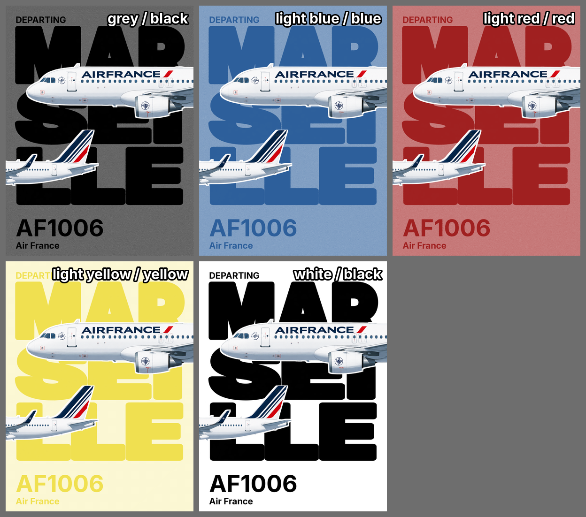
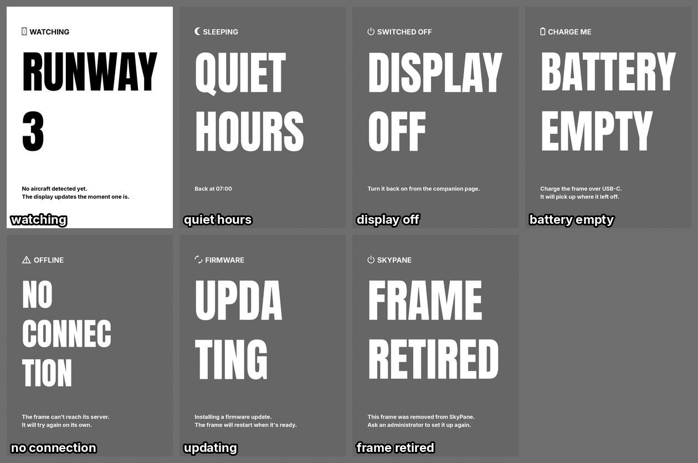

# E-ink plane screen: as-built spec

Reference commit: c9ce584 (branch docs/design-system-update). Source of truth is the code in
`server/plane/render/giant/`, `server/screen_layouts.py`, `server/themes.py`, `server/pairings.py`,
`server/panel_format.py`. This spec is derived from the code, not from
`.planning/notes/plane-screen-design-brief.md` (kept as the original exploration note). The work shipped in
phase 62 (`.planning/workstreams/v1-2/phases/62-plane-screen-redesign/`, CONTEXT D-xx decisions, 13 plans).
A user-level description already exists in `docs/plane-screen-layouts.md`.

Status tags: SHIPPED = in code at c9ce584; DECISION = chosen by the owner/phase, recorded; OPEN = unresolved.

## 1. Purpose and scope (SHIPPED)

The "giant lettering" family draws the real-time flight (DEPARTING / ARRIVING / OVERHEAD) on the e-ink panel:
the destination (or origin) city as huge Anton lettering, an aircraft illustration over it, and small text
(direction word, flight number, airline). It also draws seven calm status screens (watching, sleeping, etc.).
The older "classic" card layout is kept untouched (byte for byte) and remains selectable.
Out of scope: pairing screen (not in `giant/status.py`), companion UI.

Dispatch (`server/plane/render/layout.py:473-545`, `build_canvas`): the profile theme is degraded to the
profile's inks; hold kinds first (`_hold_kind`), then active flight (departing/arriving/overhead) to
`giant.build_canvas`, otherwise classic/landscape card. Paint order (`compose._compose`): field, band,
lettering, aircraft + halo, small text, status marks.

## 2. Geometry (SHIPPED)

Canvases are "P" mode with the six Spectra 6 indices only; every mask is hard-thresholded (`MASK_THRESHOLD = 127`).
Orientation comes from the hardware profile, not from config (section 11).

### 2.1 Portrait 1200x1600 (`compose.py`, fractions of the canvas; pixels at 1200x1600)

| Element | Value |
|---|---|
| Lettering box | x 40..1160 (1120 wide, `split.BOX_WIDTH_PX`), y 130..1290 (1160 high, `BOX_HEIGHT_PX`) |
| Line slot | box height / n lines; cap height = slot - `LINE_GAP_PX` 14 (n=1: 1146, n=2: 566, n=3: 373) |
| Shrink flag | block height x `SHRINK_BLOCK_FRAC` 0.85 = 986 (top 130, bottom 1116) |
| Margin | `MARGIN_FRAC` 64/1200 = 64 px (lettering box side margin is 40) |
| Direction word | Inter Bold 56 px, top-left at (64, 56), all layouts |
| Flight number | Inter Bold 124 px, top y 1290, right-aligned at x 1136, max width 600 (0.5 w); `MAX_FLIGHT_CHARS` 12 |
| Airline name | Inter Bold 48 px, top y 1432, right-aligned at x 1136, max width 1072; hidden when the airline is itself the lettering |

Small-text positions are identical in all four portrait layouts. No ellipsis or truncation of text anywhere
in `giant/`.

### 2.2 Landscape 800x480 (`geometry_landscape.py`, `compose_landscape.py`)

Margin 28 px; flight number 64 px; airline 26 px; direction word 24 px at (28, 12), on all layouts;
lettering top y 52; lettering is ONE stretched line, box x 16..784. Flight max width min(room, 0.45 w).
Left footer shifts right when battery/fault marks show (`FOOTER_X_BATTERY` 0.17, `FOOTER_X_FAULT` 0.5).

| Layout | Lettering box y | Aircraft | Footer |
|---|---|---|---|
| b | 52..330 | whole, width 600, centre (400, 190) | left x 28, flight top 358, airline top 428 |
| a | 52..340 | halves: nose plane 800, rear plane 540, nose left 416, rear right 258, nose centre y 105, rear bottom y 456 | left, starts x 430, flight top 356, airline top 426 |
| c | 52..330 | whole, width 430, centre (550, 400) | left x 28, flight top 356, airline top 426 |
| a_diagonal | 52..340 | as a | right-aligned at x 772, flight top 360, airline top 428 |

## 3. Layouts (SHIPPED, default DECISION)

`server/screen_layouts.py`: `LAYOUT_IDS = ("classic", "a", "b", "c", "a_diagonal")`, `DEFAULT_LAYOUT_ID = "b"`
(the only place the default is written). Unknown or missing value resolves to `b` (`normalise_layout_id`).

Selection: per-frame config key `layout` in device_config (read at `server/device_config.py:315`, written only
when different from the default; saving `b` removes the key, `:452-454`). The poll cycle resolves it in
`poll_cycle.py:_layout_id` and passes it to `render.build_canvas`. DECISION: owner confirmed default B on the
real panel on 2026-11-10 (verbal; recorded in `62-13-SUMMARY.md` under the phase 62 directory).

Portrait layouts (reference pixels):
- **b (default)**: whole aircraft, painted width 1120, centre (600, 710), over the lettering; white halo 8 px
  (`HALO_RADIUS_FRAC`, binary max-filter). No band.
- **a**: aircraft cut into nose and rear halves that bleed off the canvas: nose plane width 2200, cockpit tip
  x 130, centre y 470; rear plane width 1250, tail end x 595, bottom y 1275; cut columns overshoot 30 px.
  Cut point = thinnest stretch within 40-70% of opaque width (automatic heuristic, no per-type table).
- **c** (`compose_c.py`): lettering box y 138..888 (750 high), whole aircraft width 1116, centre (600, 1072).
- **a_diagonal**: layout a plus a diagonal band (section 5). There is no B+diagonal or C+diagonal.
- **classic**: legacy card, unchanged.

Layouts without their own composer fall back to the default's composer (`giant/__init__.py`); today all four
have composers in both orientations. Size equal width/height falls back to classic (`giant.supports`).

## 4. Colour (SHIPPED)

### 4.1 Spectra 6 palette (`panel_format.PALETTE_RGB`) and wire nibbles

| Colour | RGB | Nibble |
|---|---|---|
| black | 0,0,0 | 0 |
| white | 255,255,255 | 1 |
| yellow | 240,224,80 | 2 |
| red | 160,32,32 | 3 |
| blue | 45,95,155 | 5 |
| green | 50,105,65 | 6 |

Yellow and red are marked "interim, on-glass confirmed"; blue and green were darkened because real ink is more
muted. Nibble 4 is skipped. No intermediate colour exists: every tone is a two-colour dither.

### 4.2 The five pairings (`server/pairings.py:PAIRINGS`)

| id | field | lettering | lighten | small text dithered to black | band allowed |
|---|---|---|---|---|---|
| grey | black dithered with white | black | 0.4 | no | yes |
| blue_light | blue dithered | blue | 0.4 | no | yes |
| red_light | red dithered | red | 0.4 | no | yes |
| yellow_light | yellow dithered | yellow | 0.75 | yes (0.45) | yes |
| white | flat white | black | none | no | no |

Field = Floyd-Steinberg dither of {ink, white} toward the target `round(c + (255-c)*lighten)`
(`plane/dither.py`, `giant/field.py:field_pattern`). Resulting averages: grey 102,102,102; blue 111,159,195;
red 198,121,121; yellow 251,247,211. Yellow needs 0.75 because 0.4 would be too dark behind yellow lettering.
Small text on yellow: dither of yellow and black, `YELLOW_TEXT_DARKEN = 0.45` (about 132,123,44).
Battery and source-fault marks are black on yellow, lettering ink otherwise. `giant/palette_check.py` is a
separate palette assertion from classic (so yellow at 0.75 passes).

### 4.3 Themes to pairing

All 31 themes (18 legacy + 13 generated, `themes.py`) still exist; `pairings.pairing_for_theme` maps each
read-time by the colour of `departing_index` (or the band colour when the field is white and a band exists):
black to grey, yellow to yellow_light, red to red_light, blue to blue_light, white to white, GREEN TO GREY (no
green pairing). Default theme is `white` (`themes.DEFAULT_THEME_ID`), so an unconfigured frame is white.
`departing_index == arriving_index` in every theme, so ARRIVING never has a different colour; the optional
config `theme_arriving` (`plane/colour_rules.py`) can pick a different theme but is subject to the same mapping.
There is no separate pairing config key. Calm status screens ignore themes (section 8).

## 5. Diagonal band (SHIPPED, a_diagonal only)

Polygon from `style.BAND_*_FRAC`: top edge x 0.5818 w to 0.8523 w at y=0; bottom edge x 0.0742 w to 0.4772 w
at y=h. Painted solid in the pairing's lettering ink; lettering and small text that fall inside the band take
the field pattern (dithered, not a flat shade). With the white pairing `band_allowed` is false and a_diagonal
draws as a.

## 6. Typography (SHIPPED)

- City lettering: Anton Regular, vendored (`server/assets/fonts/Anton-Regular.ttf`, `Anton-OFL.txt`, entry in
  `server/assets/fonts/VENDOR.md`). Rendered at 600 px supersample, resized (LANCZOS) to the slot, binarised.
  No added stroke. Each line is stretched to the full box width AND to the slot height (letters are distorted,
  no natural proportions on flight screens). Accent overhang is kept.
- Small text: Inter Bold (`server/assets/fonts/Inter-Bold.ttf`, `giant/fonts.py`).
- Fitting rule (`compose._fit_font`): start at the nominal size, step down 2 px until the string fits the max
  width; floor `MIN_TEXT_PX = 16`. Below the floor the text just overflows (no ellipsis).
- Accents: Anton coverage tested per glyph; if the city cannot be drawn, retry with NFKD ASCII fallback
  (non-ASCII dropped).

## 7. City-name rules and states (SHIPPED, D-09, D-10)

Source city: DEPARTING and OVERHEAD show `route["destination_city"]`; ARRIVING shows `route["origin_city"]`.
Fallbacks: if Anton cannot draw the city, the airline name is the lettering (and the small airline line is
hidden); otherwise "Unknown flight" (UNKNOWN / FLIGHT).

`split.normalise_destination`: NFC, dash variants to "-", whitespace collapsed, UPPERCASE, capped at 80 chars.

Split rules (`giant/split.py`, no syllable dictionary; pure width balance):
- Landscape: always one line, hyphens turned into spaces.
- Portrait, names of 3 letters or fewer (`SHORT_NAME_LETTERS`): one line (PAU, AIX). "Nice", "Lyon", "Rome"
  (4 letters) are split NI/CE, LY/ON, RO/ME.
- Multi-word names (space or hyphen): break only between words, 2 to `MAX_LINES` 3 lines, min 2 letters per
  line; hyphens are dropped from the lettering.
- Single words: 2 or 3 chunks, each at least 2 letters and containing a vowel (relaxed if impossible), never
  cutting protected groups (CH, PH, TH, GN, QU, SH, CK, GH, EAU, OU, EU, AU, AI, EI, OI).
- Cost: max |ln(box_w / (natural_width x slot_h))| plus 0.12 per intra-word cut. If the minimum log-stretch is
  below ln 0.6 (`SQUEEZE_FLOOR`) the block shrinks to 0.85 of the box height instead of squeezing further.

Computed examples: Marseille MARS/EILLE; New York NEW/YORK; Bordeaux BORD/EAUX; Toulouse TOUL/OUSE;
Barcelona BARC/ELONA; Casablanca CASAB/LANCA; London LON/DON; Paris PA/RIS; Pau PAU;
Villefranche-sur-Saone VILLEFRANCHE/SUR/SAONE (shrink); Clermont-Ferrand CLERMONT/FERRAND (shrink);
Saint-Denis de la Reunion SAINT/DENIS DE/LA REUNION.

### States

DEPARTING, ARRIVING and OVERHEAD share one composition; the only differences are the direction word
(`style.STATE_LABEL_TEXT`: "DEPARTING", "ARRIVING", "OVERHEAD") and the city (origin when ARRIVING;
OVERHEAD behaves like departing). No colour difference, no runway tag, no "NEARBY . N KM" or "SET A LOCATION"
tag on giant flight screens (only the classic card draws them). The previous-flight card is gone.

## 8. Generic and calm status screens (SHIPPED, D-13)

`giant/status.py`, kinds: watching, quiet_hours, display_off, battery_empty, no_connection, updating, retired.
The dispatcher (`layout._hold_kind`) itself returns only battery_empty, display_off, quiet_hours and watching
(flight absent or state "empty"); the other three are built through `status.build_status` by other callers
(firmware mask generation). Under classic the legacy hold screens remain.

Layout (portrait, k = width/1200): margin 110k; icon top 120k, height 120k (production glyph, supersampled x4);
label Inter Bold 52k at y 262k; giant lines (Anton, flush left, whole words, natural proportions, not stretched)
in zone y 380k..1180k (two 400k slots), max px = min(330/1200 w, 0.8 x slot) = 320 at k=1, fitted to width
w - 2 margin; body Inter Bold 40k at y 1290k, line step 58k. Landscape derives from height h: margin 6.9% h,
icon 12.5% h, label 22/480 h, giants from y 150/480 h with max 0.25 h, body 20/480 h, step 28/480 h.

Colours: watching = flat white field, black ink. All other kinds = black field dithered toward white (0.4,
grey), white ink; `flat=True` gives pure black/white for firmware masks. Themes and pairings are ignored.
Battery-low glyph and source-fault badge appear only on watching, quiet_hours, display_off.

| Kind | Label | Giant lines | Body |
|---|---|---|---|
| watching | WATCHING | RUNWAY / 3 (from "Watching Runway 3"); other runway RUNWAY / 06/24; position id WITHIN / 9 KM; no location SET A / LOCATION | "No aircraft detected yet." / "The display updates the moment one is." (no location: "This frame has no location yet." / "Choose one in the companion app.") |
| quiet_hours | SLEEPING | QUIET / HOURS | "Back at HH:MM" (empty without end time) |
| display_off | SWITCHED OFF | DISPLAY / OFF | "Switched off from the companion page." / "Turn it back on there anytime." |
| battery_empty | CHARGE ME | BATTERY / EMPTY | "Charge the frame over USB-C." / "It will pick up where it left off." |
| no_connection | OFFLINE | NO / CONNECTION | "The frame can't reach its server." / "It will try again on its own." |
| updating | INSTALLING | FIRMWARE / UPDATE | "Installing a firmware update." / "The frame will restart when it's ready." |
| retired | SKYPANE | FRAME / RETIRED | "This frame was removed from SkyPane." / "Ask an administrator to set it up again." |

## 9. Golden fixtures and tests (SHIPPED)

`server/fixtures/golden/giant_render_baseline.json` and `legacy_render_baseline.json` hold sha256 and byte
counts only (no images); the giant file covers 84 cases per the phase VERIFICATION. Test:
`server/test_golden_giant_render.py` (skips on Pillow version mismatch). Visual references for as-built output
therefore do not exist in the repo; the note's images in `.planning/notes/plane-screen-design-brief/` are
exploration mocks (for example `primary-layout-1200x1600.png` shows MAR/SEI/LLE, which the code does not produce).

## 10. Selection summary: CLI versus product default

Product default is `b` (`DEFAULT_LAYOUT_ID`). The render CLI `--layout` defaults to `classic`
(`server/plane/render/cli.py:142-144`), so a bare CLI preview does not show what a frame shows. (OPEN, see 13.)

## 11. Orientation from hardware (SHIPPED)

Not a config key. `giant/__init__.py:_table(size)`: width < height uses portrait composers, otherwise landscape.
Profiles in `server/hardware.py`: `xiao-ee02-13in3-spectra6` 1200x1600 portrait (production), `sim-ee02-clone`
1200x1600 portrait, `sim-landscape-800x480` landscape. The landscape profile is available only when
`SKYPANE_SIM_HARDWARE=1` (`hardware.py` `SIM_ENV_VAR`). The real Seeed EE04 7.3in 800x480 is only a planned
slot and cannot be selected.

## 12. Differences from the original design note

| Topic | Original note | As built |
|---|---|---|
| Default layout | Open question; A the reference mock | B default (DECISION 2026-11-10); four layouts + classic |
| Diagonal band | Built on A and B | a_diagonal only; no B+diagonal |
| Flight number | About 150 px bottom-left, then 124 px right with band | 124 px, right-aligned, all portrait layouts; y 1290 |
| Lettering stroke | At most 1 px added | None |
| Long-name split | 3 lines, syllables (MAR/SEI/LLE) | 2 lines by width balance (MARS/EILLE, BORD/EAUX); 3 only for multi-word |
| Short names | Never a single line | 3 letters or fewer stay on one line (PAU, AIX) |
| Arrival colour | Green proposed | None; same colour in all states; green maps to grey |
| 18 themes | Reduce to the 5 pairings | All 31 kept, mapped to pairings |
| Tags (NEARBY, SET A LOCATION) | Follow flight screens | Only the direction word; tags only in watching headline |
| Anton | Not vendored | Vendored with OFL and VENDOR.md |
| Small-text font | Not specified | Inter Bold |
| Landscape status screens | Not explored | Built |
| Aircraft position vs line count | May need to follow | Fixed |
| Per-aircraft crop fractions | Per-type table or heuristic | Automatic thinnest-fuselage heuristic |
| Band lettering shade | Pairing's light shade | Dithered field pattern |
| Dither limit | Helper asserts below 0.5, yellow needs 0.75 | Giant palette check separate; yellow 0.75 allowed |
| No-connection / updating masks | Firmware masks from old canvases | Regenerated from the calm canvases (`firmware/tools/gen_fault_screen.py`, bbox guard 200 KB) |
| Golden fixtures | New layout needs its own | Done (hash only) |

## 13. Open questions and known gaps (OPEN)

1. CLI `--layout` default `classic` versus product default `b`; align or document.
2. Landscape is reachable only on the simulated profile; no production landscape hardware selectable.
3. No image fixtures: goldens are hashes only, so a visual as-built reference must be rendered on demand.
4. Green has no pairing; every green theme renders grey. Whether an arrival colour should exist is undecided.
5. Very long single-chunk names can be squeezed very narrow (for example VILLEFRANCHE across 1120 px) even with the shrink flag.
6. Text that cannot fit at 16 px overflows silently (no ellipsis by design, but untested at extremes).
7. NEARBY . N KM and SET A LOCATION tags are absent from giant flight screens; confirm that is intended.
8. B+diagonal and C+diagonal were never built; confirm they are dropped.
9. Real-panel check of layout B was verbal and on a non-live unit; no written handoff file exists.
